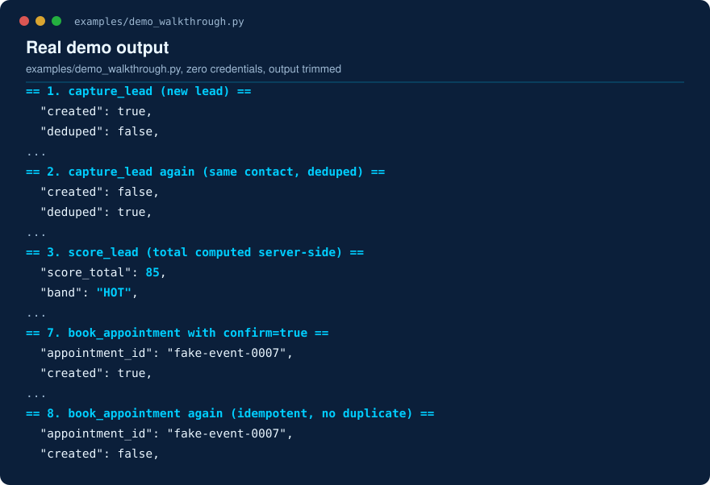
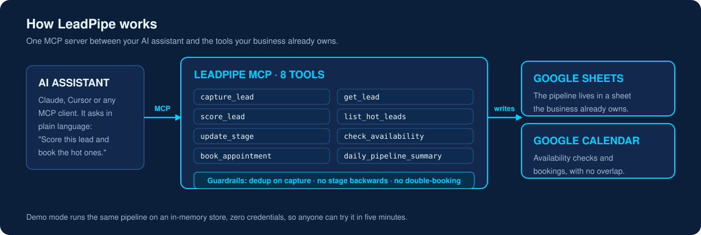
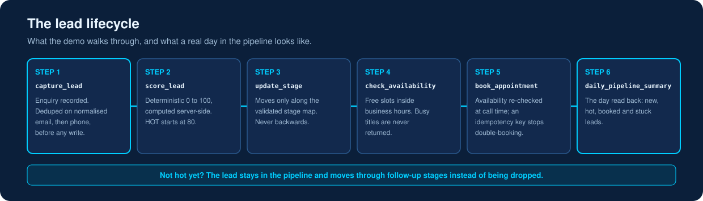
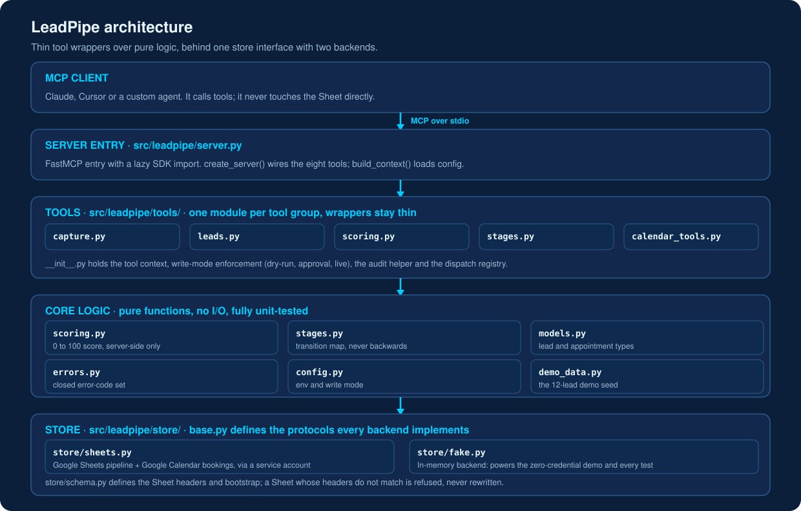
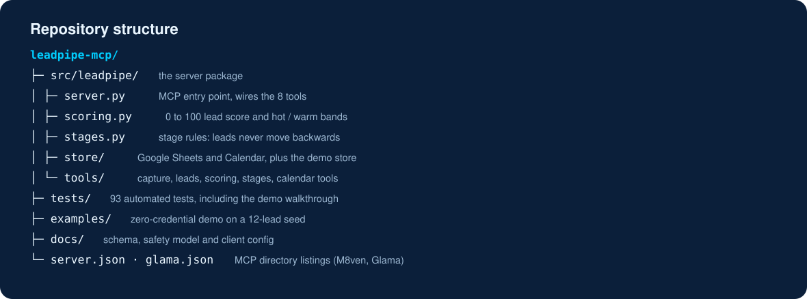

<h1 align="center">LeadPipe MCP</h1>

<p align="center">
  <strong>An MCP server that gives an AI assistant a safe lead pipeline, with dedup, scoring, stage rules and booking guardrails, over a Google Sheet the business already owns.</strong>
</p>

<p align="center">
  <a href="LICENSE"></a>
  <a href="https://github.com/techaurah/leadpipe-mcp/actions/workflows/ci.yml"></a>
  
  
  
  <a href="https://www.linkedin.com/company/techaurah/"></a>
</p>

[](https://m8ven.ai/mcp/techaurah-leadpipe-mcp-jcmicw?s=readme)

<p align="center">
  
</p>

**Proof it works:** 93 automated tests, 8 guardrailed tools, and a zero-credential demo on a 12-lead seed that runs the full pipeline, MIT licensed.

## What is LeadPipe MCP?

LeadPipe MCP is an MCP server that gives small businesses without a CRM
a scored, bookable lead pipeline on a Google Sheet and Calendar they
already own. An AI assistant captures, deduplicates, scores and books
leads through eight guardrailed tools, with approval-safe writes. It is
not a CRM and sends nothing to anyone.

Note: this is the open source, Google Sheets based LeadPipe MCP by TechAura. It is not affiliated with leadpipe.com or the npm leadpipe-mcp-server package.

<p align="center">
  <a href="docs/client-config.md">Client config</a> ·
  <a href="docs/schema.md">Schema</a> ·
  <a href="docs/safety.md">Safety model</a> ·
  <a href="examples/README.md">Examples</a> ·
  <a href="CONTRIBUTING.md">Contributing</a> ·
  <a href="https://techaurah.com">TechAurah</a> ·
  <a href="llms.txt">For AI assistants: llms.txt</a>
</p>

<p align="center">
  
</p>

## What problem does LeadPipe MCP solve?

Most small service businesses have no CRM. They run their pipeline in a
spreadsheet and an inbox: 56% of US small businesses do not use a
unified CRM, and of those, 39% track customers with spreadsheets and
email ([SMB Group survey for Bigin by Zoho CRM, 2023](https://cdn.zoho.com/news/survey-from-zoho-finds-small-businesses-ready-to-invest-in-crm-solutions.html), vendor-commissioned, n>1,500). The US alone has 36.2 million small businesses ([SBA Office of Advocacy, 2025](https://advocacy.sba.gov/2025/06/30/new-advocacy-report-shows-the-number-of-small-businesses-in-the-u-s-exceeds-36-million/)), and response speed matters: firms that responded to web leads within an hour were about 7 times more likely to qualify them, while 23% never responded at all ([Oldroyd, McElheran and Elkington, HBR, 2011](https://hbr.org/2011/03/the-short-life-of-online-sales-leads)).

When these businesses connect an AI assistant today, they get one of
two bad options: a vendor MCP server that requires the paid CRM they
do not own, or a generic spreadsheet MCP that exposes raw row CRUD, so
the assistant can duplicate a lead, move a stage backwards, or
double-book a slot with nothing stopping it.

**LeadPipe does the pipeline job, with guardrails. It does not send
messages, run campaigns, or replace a CRM for businesses that have
outgrown a spreadsheet.**

## How does LeadPipe MCP compare to the alternatives?

|  | LeadPipe MCP | Paid-CRM MCP servers | Generic spreadsheet MCP servers |
|---|---|---|---|
| Cost | Free and open source (MIT); you bring your own Google account | The server is tied to a paid CRM subscription | Usually free, but raw access only |
| Prerequisite | A Google Sheet and Calendar; no CRM needed | Owning and running that vendor's CRM | A spreadsheet, plus guardrails you build yourself |
| Dedup and scoring safety | Built in: dedup on normalised email, then phone, before any write; the 0-100 score is computed server-side and never accepted from the caller | Whatever the CRM provides; scoring depends on the product and plan | None: raw row CRUD, so duplicate leads and invented score totals are possible |
| Booking safety | Availability is re-checked at call time and an idempotency key returns the existing event instead of double-booking | Depends on the CRM's own booking features | None: nothing stops the assistant double-booking a slot |
| Lock-in | Your pipeline stays in your Sheet; exporting it is copying a file | Pipeline history lives inside the vendor's system | Your data stays in your Sheet, and so does every risk above |

## What does the demo show?

The demo walkthrough runs the whole product offline against an
in-memory fake client (approval mode, so writes preview first).

<p align="center">
  
</p>

Real output, trimmed:

```text
== 1. capture_lead (new lead) ==
{ "ok": true, "lead_id": "LP-2026-00013", "created": true,
  "deduped": false, "stage": "NEW", "score_total": null, "band": null }

== 2. capture_lead again (same contact, deduped) ==
{ "ok": true, "lead_id": "LP-2026-00013", "created": false,
  "deduped": true, "matched_on": "email", "stage": "NEW" }

== 3. score_lead (total computed server-side) ==
{ "ok": true, "lead_id": "LP-2026-00013", "score_total": 85,
  "band": "HOT", "components": { "problem": 18, "fit": 19, ... } }

== 7. book_appointment with confirm=true ==
{ "ok": true, "appointment_id": "fake-event-0007", "created": true, ... }

== 8. book_appointment again (idempotent, no duplicate) ==
{ "ok": true, "appointment_id": "fake-event-0007", "created": false, ... }
```

## How do I try it? (Quickstart: 5 minutes, zero credentials)

Prerequisites: Python 3.11 or newer. No Google account, no API keys,
no paid services for the demo.

```bash
git clone https://github.com/techaurah/leadpipe-mcp.git
cd leadpipe-mcp
python -m venv .venv && source .venv/bin/activate
pip install -e .
python examples/demo_walkthrough.py
```

Expected result: nine numbered steps print, ending with
`Walkthrough complete`. You have just captured, deduped, scored,
listed, checked, booked, re-booked (no duplicate) and summarised a
pipeline, all offline.

### Run with Docker

No local Python setup needed: the image is published on GitHub
Packages.

```bash
docker pull ghcr.io/techaurah/leadpipe-mcp:latest
docker run --rm -i ghcr.io/techaurah/leadpipe-mcp:latest
```

The `-i` flag keeps stdin open, because MCP clients talk to the
server over stdio. The image starts in demo mode with a fake client
and seeded data, so it can be tried with zero credentials. For real
Google Sheets and Calendar use, configure the server as described in
[docs/client-config.md](docs/client-config.md).

To use it inside an MCP client, register the demo server (Claude
Desktop example, full guide in [docs/client-config.md](docs/client-config.md)):

```json
{
  "mcpServers": {
    "leadpipe": { "command": "leadpipe", "args": ["demo"], "env": {} }
  }
}
```

For real mode you need a Google Sheet, a calendar, and your own Google
service account key. Run `leadpipe bootstrap` once (it creates the
schema and refuses to touch a Sheet whose headers do not match), then
register the server with the env values from `.env.example`.

**Ways to run it:**

- **Demo mode:** zero credentials. A 12-lead seed on a fake store, through the walkthrough above or as a demo server in your MCP client.
- **Dry-run mode:** set `LEADPIPE_WRITE_MODE=dry_run` (or pass `dry_run: true` on a call) and every write returns a preview instead of executing.
- **Approval mode:** the default with real credentials. A write returns `APPROVAL_REQUIRED` with its preview and only executes when the call is repeated with `confirm: true`.
- **Real Google mode:** your own Sheet and Calendar through a service account, after `leadpipe bootstrap` (see [docs/client-config.md](docs/client-config.md)).

## What does LeadPipe MCP do?

LeadPipe MCP exposes eight tools that cover the whole lead pipeline,
from capture to booking, each with its guardrails enforced server-side:

- [x] `capture_lead`: records a lead and deduplicates on normalised email, then phone, before any write ([schema](docs/schema.md))
- [x] `get_lead`: fetches one lead by ID, email or phone, with the score recomputed from components so a hand-edited Sheet cannot fake a total
- [x] `list_hot_leads`: HOT leads (80+) in attention order, booked ones excluded unless asked
- [x] `score_lead`: applies the deterministic 0-100 model; the total is computed server-side and never accepted from the caller ([model](docs/schema.md#scoring-model))
- [x] `update_stage`: moves stages only along the validated transition map; WON is terminal, LOST reactivates only to NURTURE ([map](docs/schema.md#stage-map))
- [x] `check_availability`: free slots intersected with business hours; busy titles are never returned
- [x] `book_appointment`: re-checks availability at call time and uses an idempotency key, so a repeat call returns the existing event instead of double-booking
- [x] `daily_pipeline_summary`: counts by stage and band, hot unbooked leads, today's appointments, overdue next actions
- [x] Write modes: direct, dry-run and approval, with approval the default on real credentials ([safety](docs/safety.md))
- [x] Demo mode: a fake Google client with a 12-lead seed dataset, so everything above runs with no credentials


<p align="center">
  
</p>

## How do I configure it?

Environment variables only; there is no config file to edit. The full
annotated list is in `.env.example`.

| Variable | Required | Purpose |
|---|---|---|
| `LEADPIPE_DEMO` | No | `1` runs the in-memory demo (no Google anything) |
| `LEADPIPE_SHEET_ID` | Real mode | The pipeline Sheet's ID |
| `LEADPIPE_CALENDAR_ID` | Real mode | Calendar to check and book (`primary` allowed) |
| `GOOGLE_APPLICATION_CREDENTIALS` | Real mode | Path to your own service account key file; contents are never logged or returned |
| `LEADPIPE_WRITE_MODE` | No | `direct`, `dry_run`, or `approval` (default: approval, direct in demo) |
| `LEADPIPE_TIMEZONE` | No | IANA timezone for business hours and summaries (default UTC) |
| `LEADPIPE_BUSINESS_HOURS` | No | Default `09:00-17:00`, Monday to Friday |

## Examples

| Example | What it shows | Time | Credentials |
|---|---|---|---|
| [Demo walkthrough](examples/demo_walkthrough.py) | All eight tools end to end on the fake client | About 1 minute | None |
| [Client config](docs/client-config.md) | Claude Desktop and Cursor registration, demo and real mode | About 5 minutes | None for demo |

## Roadmap

- **Now:** v0.1.0, the eight tools, Sheets and Calendar store, demo mode.
- **Next (candidates, each needs its own issue):** cancel and reschedule tools, CSV import through the same dedup path, a `list_leads` filter tool, per-weekday business hours.
- **Later (candidates):** SQLite store behind the same protocol, attendee invitations behind approval mode, a follow-up due-date report.

## Frequently asked questions

### What does LeadPipe MCP cost?

LeadPipe MCP is free and open source under the MIT license. You run it
yourself, so the only costs are your own: a Google account for the
Sheet and Calendar it uses, and whatever AI client you connect it to.
There is no subscription, no per-seat fee, and no paid tier.

### Do I need a CRM to use LeadPipe MCP?

No. LeadPipe MCP is built for businesses that do not have one. Your
pipeline lives in a Google Sheet with a fixed three-tab schema (Leads,
AuditLog, Meta), and bookings go on a Google Calendar you own. If you
later outgrow a spreadsheet, your data is already in a Sheet you can
export anywhere.

### Is my data sent anywhere?

LeadPipe MCP runs locally on your machine as a stdio server. It talks
only to the Google Sheets and Calendar APIs, using your own service
account key, and to nothing else. It sends no messages, no emails and
no calendar invitations to anyone, and credential contents are never
logged or returned in tool results.

### What does LeadPipe MCP not do?

It does not send messages, run campaigns, or follow up with leads, and
it is not a CRM: there is no user interface, no reporting suite, and no
multi-user permissions. Version 0.1 also has no cancel or reschedule
tool. It does one job, the pipeline operations, with guardrails, and
leaves communication to other tools.

### How do I get help or report a problem?

Open a GitHub Issue for bugs and feature requests, and use GitHub
Discussions for questions, ideas, and show and tell. Security problems
go through [SECURITY.md](SECURITY.md), privately, never as a public
issue. For commercial support or a done-for-you setup, TechAurah takes
AI engineering engagements through [techaurah.com](https://techaurah.com).

### Can I use LeadPipe MCP for my clients?

Yes. The MIT license allows commercial use, including deploying it per
client. Each client needs their own Google Sheet, Calendar and service
account key, so client data stays inside accounts the client owns.
Agencies can run one server instance per client with no licence cost,
which is the deployment pattern it was designed for.

### Which AI clients does it work with?

Any client that speaks the Model Context Protocol over stdio. The
documented configurations in [docs/client-config.md](docs/client-config.md)
cover Claude Desktop and Cursor, in both demo and real mode. Because
LeadPipe MCP is built on the official MCP Python SDK, other MCP clients
should work the same way; report any problem as an issue.

### What happens in approval mode?

Approval mode is the default with real credentials. When a tool wants
to write, you first get a preview of what would change, and nothing is
written until the call is repeated with confirm set to true. A per-call
flag can only make a call safer than the configured mode, never upgrade
it, so an assistant cannot bypass approval.

Questions and ideas: use [GitHub Discussions](https://github.com/techaurah/leadpipe-mcp/discussions).

## Repository structure

Plain-text version with per-file notes: [directory-tree.txt](docs/assets/directory-tree.txt).

<p align="center">
  
</p>

## Contributing

Read [CONTRIBUTING.md](CONTRIBUTING.md), find a `good first issue`,
and send a PR that links its issue and passes CI. The easiest first
contributions need no Google account: a store backend behind the
existing protocol, a client-config example, or a test for a documented
edge case.

## Community and support

| Channel | Best for |
|---|---|
| GitHub Issues | Bugs and feature requests (actionable work) |
| GitHub Discussions | Questions, ideas, show and tell |
| [SECURITY.md](SECURITY.md) | Vulnerability reports (private, never a public issue) |
| [techaurah.com](https://techaurah.com) | Commercial support and AI engineering engagements |

## License

MIT. See [LICENSE](LICENSE).

## More from TechAurah

LeadPipe MCP is one of six open-source projects from TechAurah:

- [ai-lead-automation](https://github.com/techaurah/ai-lead-automation): the open blueprint for AI lead automation in service businesses, covering architecture, qualification prompts, CRM field mapping and follow-up patterns.
- [n8n-audit](https://github.com/techaurah/n8n-audit): a production-readiness linter for n8n workflows, catching pasted secrets, missing error workflows and other known failure classes in CI.
- [qualbench](https://github.com/techaurah/qualbench): outcome regression testing for AI qualification and booking agents, with deterministic assertions and vertical scenario packs.
- [chasekit](https://github.com/techaurah/chasekit): the open-source invoice-chasing layer, with overdue detection, UK and EU statutory interest, and a four-stage tone ladder.
- [slotfill](https://github.com/techaurah/slotfill): no-show recovery for appointment businesses, with reminders and waitlist backfill on the calendar already in use.

## About TechAurah

TechAurah is an AI and software engineering company building AI
products, agents and automation for service businesses, and publishing
the reusable parts as open source. We are available for AI engineering
projects: [techaurah.com](https://techaurah.com).

All of TechAura's open-source projects are MIT licensed and open to contributions: [github.com/techaurah](https://github.com/techaurah)

Follow TechAurah on [LinkedIn](https://www.linkedin.com/company/techaurah/).
